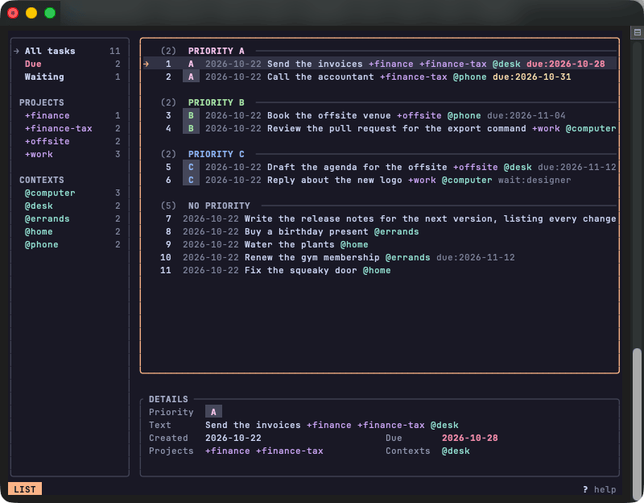

# todo

A small editor for a [todo.txt](https://github.com/todotxt/todo.txt) file: a command line to add, list and complete tasks, and a full-screen list meant for a [herdr](https://herdr.dev) popup.



## Install

It needs Rust 1.88 or later.

```sh
cargo install --locked --git https://github.com/MatthieuELIE/rust-todo --tag v0.7.3
```

This puts `todo` in `~/.cargo/bin`; drop `--tag` for the latest `main`, or run `cargo install --locked --path .` in a clone.
It is developed on macOS and its tests run on Linux; it has not been tried on Windows.

## Usage

The task file is `~/todo.txt`, or the path in `$TODO_FILE` if it is set.

```sh
todo add "(A) Call the bank"  # add a task with a priority
todo list                     # pending tasks
todo list +finance            # tasks with +finance
todo do 2                     # complete task 2
todo                          # open the full-screen list; ? shows the keys
```

## Documentation

The commands, the keys of the list, how `list` filters and colours, and the configuration are described in [the documentation](https://matthieuelie.github.io/rust-todo/).

## License

MIT, see [LICENSE](LICENSE).
