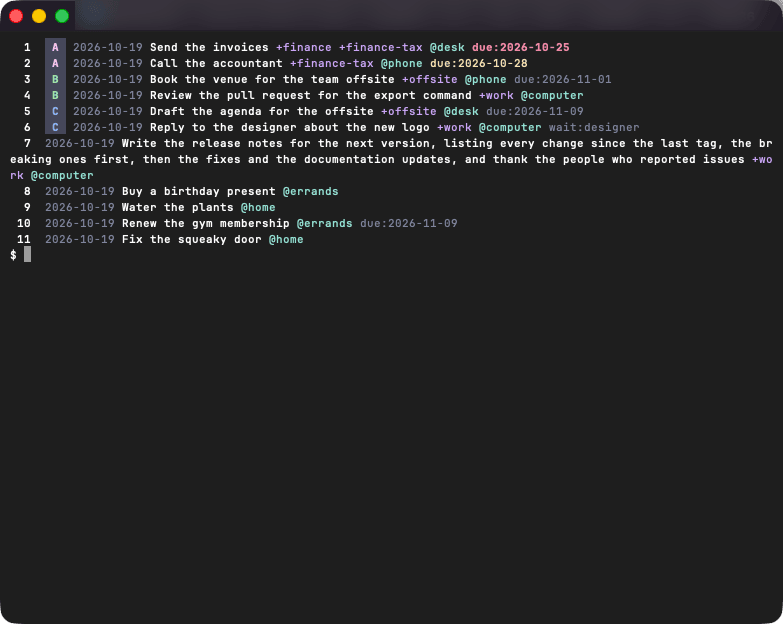

# Listing

`todo list` shows the pending tasks, and its terms narrow them down.
A task is listed when its line contains every term, and a leading `-` excludes instead.

```sh
todo list +finance        # tasks with +finance
todo list -@phone         # tasks without @phone
todo list +finance -@phone
```



`+` and `@` are plain characters, so `-+work` hides the `+work` tasks.
Terms are compared as case-insensitive literal substrings.
`--due` keeps the pending tasks due today or past, and `--done` lists `done.txt`; both are described below.

## Details

### Terms

A date is a term like any other: `todo list 2026-09` finds what was created in September, and `todo list --done 2026-09` what was created or completed then.
Flags go before terms.
In `todo list +work --due`, `--due` is one more term, excluding `-due`, and the tasks that are not due stay listed.

### Due tasks

`--due` keeps the pending tasks holding a `due:` date that is today or past.
It combines with the terms after it: `todo list --due +work`.
A done task is never due, and a `due:` that is not a `YYYY-MM-DD` date is ignored.

### Done tasks

`--done` lists `done.txt`, the file `todo do` and `todo archive` fill, instead of the task file.
Its lines are in the order of the file, numbered by their position in it, and filtered by the terms after it.
Blank lines are not counted.

A line of `done.txt` that is not a done task is listed as it is.
A done one is listed as `todo` would write it, without the priority a line such as `x (A) Pay rent` holds.
`--done` does not combine with `--due`.

### Pending tasks only

`list` shows pending tasks only.
A done task still in the task file, one typed by hand, is not listed until `todo archive` moves it.
The former `--all`, or `-a`, is refused when it comes first, where the flag used to go; further on it is a term like any other.

### Order

Tasks with a priority come first, A to E, then the rest.
Ties keep the file order.

### Colours

stdout carries task lines only, coloured when it is a terminal, otherwise plain todo.txt lines.
`NO_COLOR` and the config's `name` decide the colours, see [Configuration](config.md#no_color).

Each element of a line has its own style:

- the priority is a badge, ` A ` in its colour on a dark background (A pink, B green, C blue, D lavender, E sky);
- the creation date is greyed;
- `+projects` are mauve and `@contexts` teal;
- `key:value` words such as `wait:figma` are greyed too: a key starting with a letter, then a value, so that URLs and times like `10:30` keep their plain style;
- a `due:` date is red and bold once past and yellow on the day; later, or when it is not a `YYYY-MM-DD` date, it is greyed like any `key:value`;
- a done task is greyed and struck through as a whole, whatever its due date.

A control character found in a line of the file, such as a terminal escape sequence, is printed as `�`, so that a line cannot drive the terminal.
An empty listing says so on stderr and still exits 0.

### Differences from `todo.sh`

- Terms are literal substrings, not `grep` regular expressions: for an OR, pipe into `grep -i 'a\|b'`.
- Ties in the sort keep the file order instead of going alphabetical.
- `list` never shows done tasks: `list --done` shows `done.txt`.
- No `TODO: N of M tasks shown` footer.
